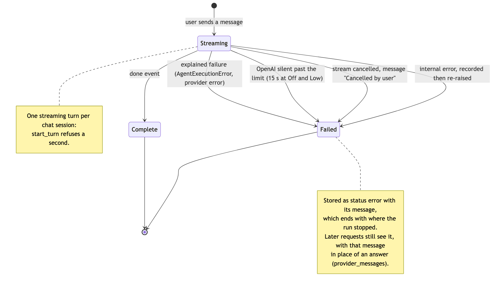
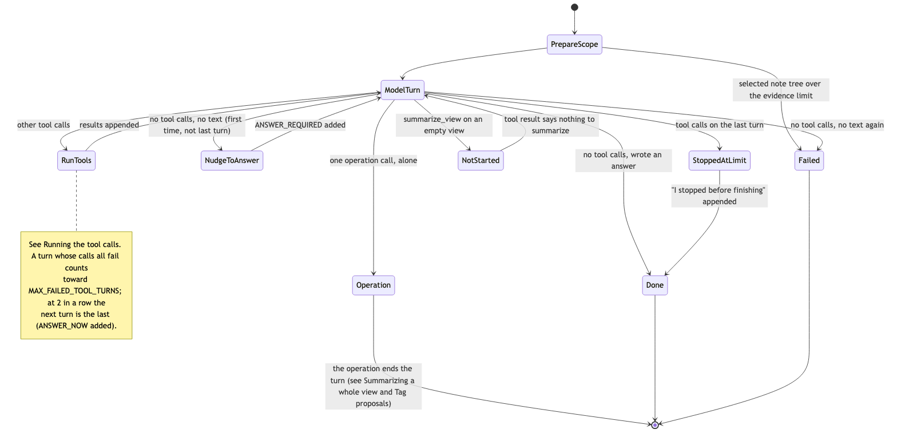
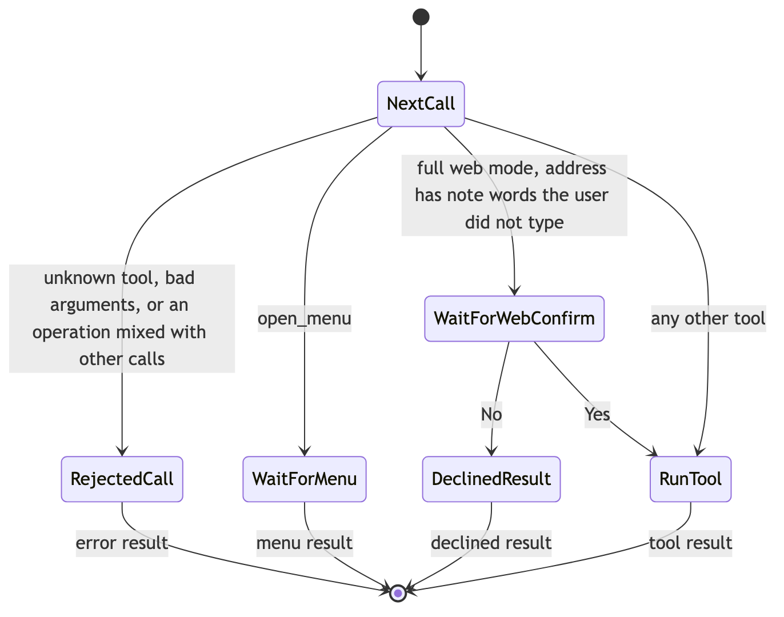
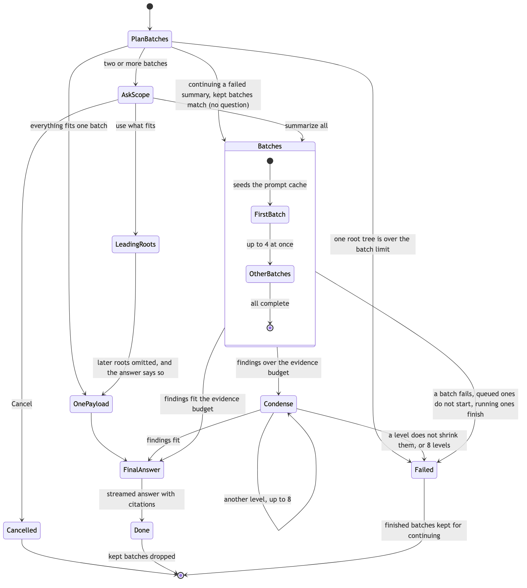
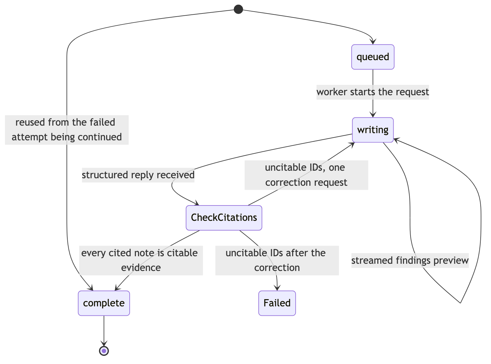
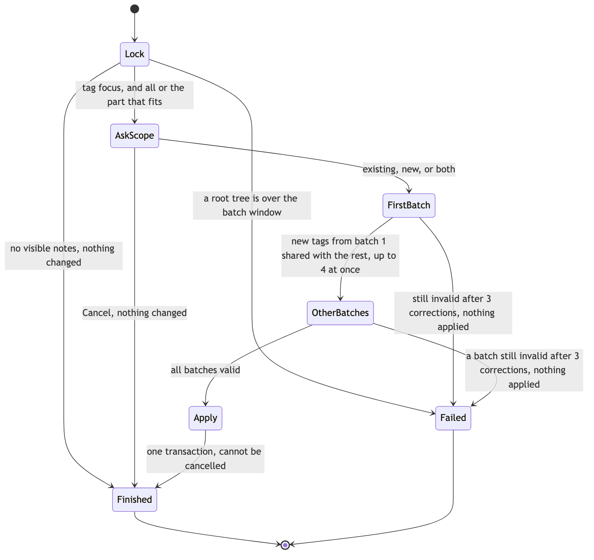
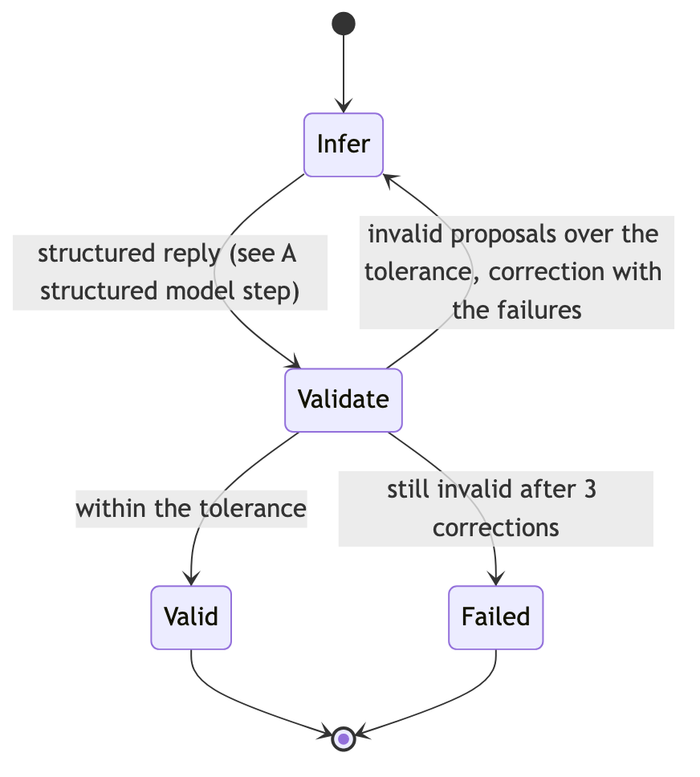
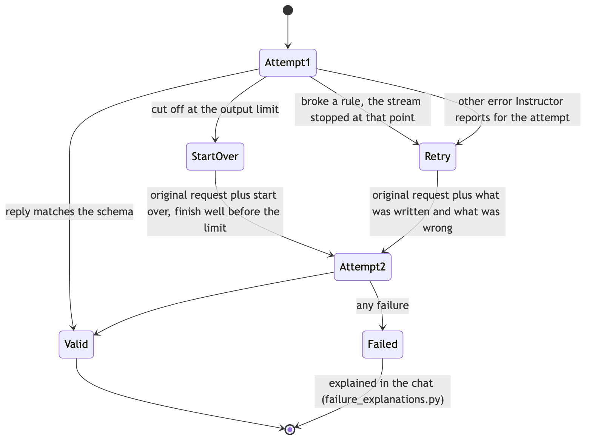

# Agent State Machines (as built)

The AI agent has no explicit state machine: its states live in nested async code,
flags and counters across `agent_loop.py`, `runtime.py`, `tagging_run.py`,
`structured_inference.py`, `ai_chat.py` and `ai_chat_stream.py`. This document maps
those implicit machines as they behave today, so gaps are visible and any later
move to explicit states (statecharts in the XState sense: nested and parallel
states, guarded transitions, explicit actions) starts from an accurate picture.

The diagrams describe the code as of October 2026. They are not generated from it;
change them with the code. Each image has a Mermaid source of the same name in `docs/diagrams/`
(for example `agent-tool-loop.mmd`); regenerate the images with
`npm run render-diagrams`. The model chooses what to do (which tools to call);
these machines decide what is allowed and what happens next.

Two of the first bugs found this way were unnamed states: a failed turn had no
place in the history (so "try that again" saw nothing), and a reply stopped
part-way was treated like no reply (so the retry resent the same request).

## A chat turn

One message from the user and the AI's reply. Code: `AiChatSessionStore`
(`start_turn`, `complete_turn`, `fail_turn`), `ChatTurnStream.events`.

## The tool-using agent loop

The model answers by calling tools until it writes an answer. Code:
`AgentLoopMixin._run_agent_loop` and `_run_agent_tool_call`. Limits:
`MAX_AGENT_TURNS = 8`, `MAX_FAILED_TOOL_TURNS = 2`.

The tool calls of one model turn run in order:

## Summarizing a whole view

The `summarize_view` operation. Code: `AgentRuntime._stream_view_summary`,
`_stream_staged_scope_summary`, `_stream_staged_summary_batches`,
`_reduce_staged_summaries`. Batches are whole root trees, in the view's order
(`InvestigationState.plan_complete_root_batches`).

Each batch has its own small machine (`batch_states` in
`_stream_staged_summary_batches`, which refuses any other transition):

## Tag proposals

The `propose_tag_generation` and `propose_tag_review` operations. Code:
`ChatTaggingRun.stream_generation`, `generate`, `stream_review`, `apply`.
Both hold the session's bulk-operation lock (`bulk_operation_guard.acquire`), so
only one runs per chat session. Nothing is written until every batch succeeds.

Every batch, the first included, runs the same loop
(`infer_validated_batch`, `_TAGGING_CORRECTION_ATTEMPTS = 3`):

Review (accept or remove pending proposals) is shorter: count the matching
proposals, finish if there are none, otherwise ask Yes/No for the exact change,
then apply in one transaction.

## A structured model step

Every structured request (summary findings, tag batches, the answer checker).
Code: `structured_inference._run_structured_attempt` and
`_structured_retry_messages`; requests are strict (`strict_structured_outputs.py`).

## Gaps the map shows

These are observations, not decisions; each would be its own change.

1. **Waiting happens inside one HTTP stream.** A pending question (summary or
   tag scope, a Yes/No confirmation, a web-address confirmation) or menu is an
   in-memory wait inside the streaming request. Reloading the page or restarting
   the server cancels the stream, the question is lost, and the turn fails as
   "Cancelled by user" even though the user cancelled nothing.
2. **Cancelled and failed are one state.** Both are stored as `error`, told apart
   only by the message text. The later model history therefore treats a Stop as a
   failed request ("If they ask to try again, redo this request").
3. **A failed batch loses the finished ones.** *Resolved:* when a batch fails (or
   the run stops), batches not started yet do not start, the running ones finish,
   and every finished batch is kept for the chat session (`summary_batch_store.py`).
   Asking again ("try that again") makes the agent call
   `summarize_view(continues_failed_summary=true)`: batches that match exactly
   (same notes and content, selected-note context, model, thinking level, prompts
   and skill) are reused, the rest run with the original question, and the scope
   question is not asked again. A new question starts fresh; success drops the
   kept batches.
4. **Retry budgets differ per flow and stack.** Tool loop: 8 turns, 2 failed tool
   turns, 1 answer nudge. Structured step: 1 retry. Summary citations: 1
   correction. Tag batches: 3 corrections, each a structured step with its own
   retry, so up to 8 model calls per batch. Summary condensing: 8 levels.
5. **Unreachable branches in tag generation.** Chat always starts generation with
   focus "unspecified", so the scope card always asks for a focus; the
   saved-policy conflict message and the plain "proceed" and "use_prefix" choices
   in `generate` are never reached.
