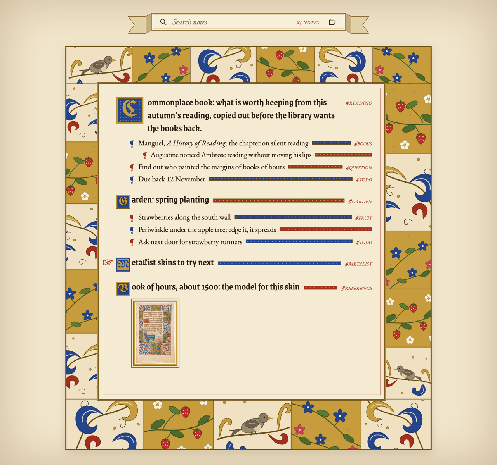
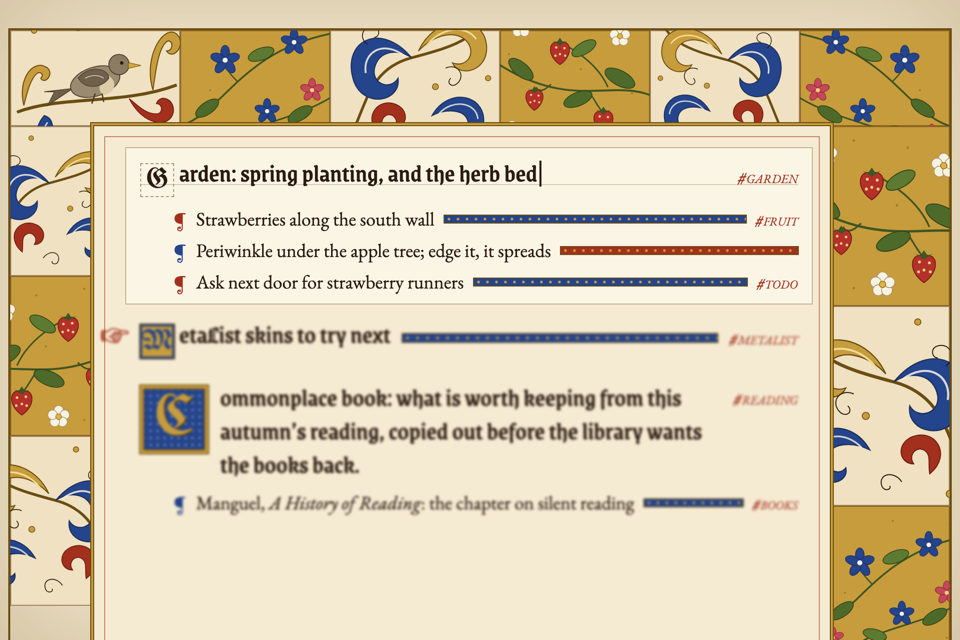
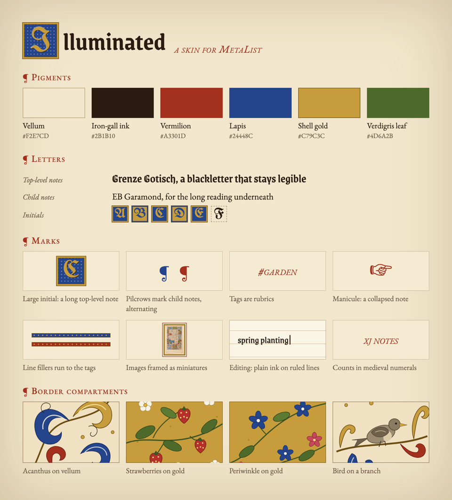

# MetaList Skins: Illuminated Manuscript Brainstorm

2026-10-18. Brainstorm only: nothing is built and no MetaList code changed. A copy of the [Claude doc](https://claude.ai/code/artifact/249446c1-680b-491c-b24d-319114dcb862); the mockup is the canvas [MetaList Illuminated Skin](https://claude.ai/artifact/52YJNGfbbzzHZ3Tb6uTNBz).

## Where this stands

Three ideas, each building on the last:

1. **Skins:** looks for MetaList beyond light and dark, starting with one modelled on a book of hours from about 1500.
2. **Border art per context:** each tab or search gets its own border, always the same one for the same context, so it works as a landmark.
3. **Medieval renditions of note images:** an AI repaints a note's image as a manuscript painting, keeping the original.

## How theming works today

MetaList has two themes, and dark mode is built from per-element overrides, not swappable values. A third look built the same way would add about 250 more overrides that drift apart. Figures are from `main.css` on 2026-10-18.

| What | Where | Why it matters for skins |
| --- | --- | --- |
| Light or dark is a `data-theme` attribute on the page, saved as `pref.theme` | `client-state-migration.js` (`resolveStoredThemePreference`) | Only `'dark'` and `'light'` are accepted |
| About 108 style variables | `app/static/css/main.css`, `:root` | Mostly sizes and widths, few colours |
| About 630 hard-coded colours | `main.css` | A skin cannot recolour them without overriding each one |
| About 246 `html[data-theme="dark"]` rules | `main.css` | Dark mode restyles element by element |
| The note itself hard-codes white and `#e6e6e6` | `main.css`, `.note` | Even the core surface is not a variable yet |
| Tags are already variables (`--note-tag-radius`, `--note-tag-border-width`, …) | `main.css`, `:root` | The pattern the rest should follow |
| Fonts and images load only from MetaList or embedded data | `app/security/http_headers.py` | Skin fonts and ornament art must ship with MetaList |
| Dialogs are dark in every theme on purpose | `main.css`, shared modal shell | A skin must decide whether it restyles them |
| Excalidraw previews and Mermaid diagrams render as light or dark | `file_previews`, Mermaid render service | A skin must say which base it uses |

## Proposed skin architecture

A skin sits on top of light or dark rather than replacing them, and the real work is turning hard-coded colours into named values first.

1. **Keep skin separate from light/dark.** A `data-skin="illuminated"` attribute sits next to `data-theme`, and each skin declares its base (illuminated sits on light). The existing light/dark logic stays as it is.
2. **One CSS file per skin**, for example `css/skins/illuminated.css`, plus its bundled fonts and SVGs. Every rule starts with `html[data-skin="illuminated"]`.
3. **Two layers per skin:**
   - Values: ink, page, accent, heading and body fonts, corner radii. Plain skins (sepia, Solarized) are only this layer.
   - Ornament: pseudo-elements, `border-image`, `::first-letter`, backgrounds. This is where the strange skins live.
4. **First, replace hard-coded colours with named values** such as `--note-surface`, `--ink` and `--rubric`. Dark mode then becomes a list of values, and most skins become small.
5. **A `pref.skin` preference.** Client preferences are key/value, so this probably needs no database schema change; to be confirmed.
6. **Its own screenshot check per skin.** The exact-position tests run on the default look, and a skin's fonts change line heights.

## The illuminated skin

Each part of a manuscript page maps onto something MetaList already draws, so the skin is decoration on the existing note structure, not a new layout.

| Manuscript | MetaList | Likely CSS |
| --- | --- | --- |
| Vellum | Warm parchment background with a faint grain | Page and note surface values |
| Iron-gall ink, textura script | Blackletter (Grenze Gotisch) for top-level notes, EB Garamond for children | Font values per note depth |
| Gold-leaf initial on a blue square | Long top-level notes open with a two-line initial | `::first-letter` |
| Small one-line initials | One-line top-level notes, alternating gold-on-blue and blue-on-gold | `::first-letter` |
| Rubrics (red text) | Tags in red small caps, no pill borders | Existing tag values |
| Line-fillers | Gold-dotted blue or red bars from the end of a line to its tags | A stretching element; only approximate in CSS |
| Pilcrows ¶ | Child-note markers, alternating red and blue | `::before` |
| Manicule ☞ | Collapsed-note toggle | Collapse toggle styling |
| Miniature | Images framed in gold and red | `img` inside note content |
| Border panels | A frame around the notes column | `border-image` or positioned SVG |
| Banderole | The search bar as a ribbon; counts in medieval numerals ("xj notes") | Search bar styling |

## Editing without moving anything

Entering edit mode takes the paint off but leaves every letter where it was, following the interaction principle that the user's point of attention stays still.

- The initial keeps its box and size. Only its colour and gold come off, leaving a dashed outline around a plain ink letter, so the text does not shift.
- The gold-dotted bars disappear. They only fill free space, so nothing else moves.
- Faint ruled lines appear under the edited note, like a scribe's prepared page.
- Children of the edited note stay sharp and decorated. Other notes blur slightly, as MetaList does today.
- Decoration and `contenteditable` do not fight: the cursor never sits inside painted ornament.

## Specimen sheet

Six colours, three typefaces and four border motifs make up the whole skin.

| Pigment | Hex | Used for |
| --- | --- | --- |
| Vellum | #F2E7CD | Page and notes |
| Iron-gall ink | #2B1B10 | Text |
| Vermilion | #A3301D | Tags, rules, alternate markers |
| Lapis | #24448C | Initials, markers, leaves |
| Shell gold | #C79C3C | Initials, panel grounds, frames |
| Verdigris leaf | #4D6A2B | Leaves and stems in the border |

Fonts: Grenze Gotisch (top-level notes), EB Garamond (child notes), UnifrakturMaguntia (initials), all under the SIL Open Font License. They would ship with MetaList, since its security rules block loading fonts from elsewhere. The mockup's border art is rough SVG drawn for the mockup; a real skin would want proper artwork.

## Border art that changes per context

Each context gets its own border, chosen by the context rather than at random, so the same tab or search always looks the same and the border works as a landmark. Random borders never get boring, but coming back to #garden would feel like somewhere new each time.

**How it is chosen:** hash the context's search query into a seed. A smarter version picks motifs from the tags in play (strawberries and periwinkle for #garden, birds and books for #reading) and falls back to the hash. Medieval painters sometimes fitted the margin pictures to the text in the same way.

| Stays the same | Varies by context |
| --- | --- |
| Border widths | How each border strip is divided into panels |
| Where the text block sits | Which motif fills each panel, and whether it is mirrored |
| The colours | Which panels have a gold background and which plain parchment |
|  | Optionally, a signature corner picture for the context |

- **Rare surprises:** marginal oddities, such as a snail jousting a knight or a rabbit with a sword, in about one context in ten. Because the choice is fixed per context, a discovered one stays there.
- **When the border changes:** on a tab switch, and on a search only once it settles, together with the new results. Following every keystroke would make it flicker.
- **Why it fits the interaction principles:** only your switch changes the border, and returning gives you what you saw before. Fixed widths mean the notes never move when the border changes.
- **Cost:** about eight motifs, a few ways to divide each strip, mirroring and the gold/parchment choice give a very large number of borders that all share one set of colours. Each context's border can be built once and kept, so switching back costs nothing.

## AI medieval renditions of note images

An AI repaints a note's image as a manuscript painting, stored beside the original and never replacing it. The two hard parts are privacy and the provider.

**Where it lives.** The files database already keeps derived pictures: `file_previews` (`app/db/file_schema.py`) holds one encrypted preview per light/dark version of an Excalidraw diagram, tagged with the file revision it came from. A rendition is the same kind of thing, in its own table, recording:

- the style that made it, so other skins can add their own
- the prompt version
- the original's content hash, so the same photo in two notes is paid for once

This changes the files database schema, so it needs a version bump, a migration step and an encryption-audit update (AGENTS.md).

**How it converts.**

- Restyle the image itself rather than describe it and draw from the description. That keeps the layout, so it is recognisably your garden and not a generic one.
- One fixed style prompt tied to the skin's colours: egg tempera, shell gold, lapis and vermilion, flat perspective, thin ink outlines, parchment ground. Version it; a new version never silently repaints old images.
- Keep the original's shape, so the painting fills exactly the original's box and nothing moves.

**When it happens.** The user starts it, because a painting appearing on its own would change the screen without their action.

- One image: right-click, *Illuminate image*; it is replaced in place.
- A whole view: *Illuminate images in this view…* with the image count and estimated cost first, progress on a floating card.
- A per-image toggle back to the original, remembered. Other skins always show the original.

**Privacy: a new path to the cloud.** Every path in `docs/security/cloud-privacy-boundary.md` today is text.

- Images go through the same privacy check: an image in a hidden note is never sent, and an image in several notes is held back if any of them is hidden.
- The phrase blacklist cannot see inside a picture (a photographed letter, a face), so show thumbnails of exactly what will be sent before sending.
- Add the new path to that document's table.

**Provider.** Claude does not generate images. Ask the AI setup whether the configured AI can make images, never check for an OpenAI key, and hide the menu item when it cannot.

**Which images.** Photos and drawings by default. Screenshots, scanned text and charts would lose their information, so they are skipped unless the user asks. Excalidraw diagrams are left out; they have their own previews.

**It grows with other skins.** Each skin can declare a rendition style: woodcut, blueprint line drawing, 1-bit dithering. Dithering and green phosphor are plain image filters that need no AI and send nothing, a cheap way to try the idea first.

## Other skins to try

Each of these stresses a different part of the skin system, so building two of them would show whether the architecture holds.

| Skin | The look | What it tests | Base |
| --- | --- | --- | --- |
| Illuminated | Book of hours: parchment, gold initials, red tags, border panels | Decoration that must never move text | Light |
| Card catalogue | Each note a typed index card, tags as stamped labels | Heavy reshaping of each note | Light |
| Green phosphor terminal | Monospace font, scanlines, block cursor | The dark base and the cursor styling | Dark |
| Blueprint | White lines on blue, notes as boxes with dimension lines | Borders and indentation lines | Dark |
| Mac System 7 | 1-bit dithered fills, pinstriped title bars on top-level notes | Dialogs, which are dark in every theme today | Light |

## Open questions and a sensible order

If this is picked up, the colour refactor comes first because every skin depends on it; the AI renditions come last because they carry the privacy and provider work.

1. Replace hard-coded colours in `main.css` with named values, and rebuild dark mode as a list of values. No visible change.
2. Add `data-skin` and `pref.skin`, then one plain skin made only of values (sepia) to prove the plumbing.
3. The illuminated skin, starting with letters and tags, then the border.
4. Border art per context.
5. Rendition styles that need no AI (dithering), then AI renditions.

- [ ] Do skins restyle dialogs, or do dialogs stay dark in every skin?
- [ ] Which do Excalidraw previews and Mermaid diagrams use under a skin: the skin's base, or something new?
- [ ] Border art: drawn by hand as SVG, or sliced from openly licensed museum scans?
- [ ] Does a search change the border only once it settles, or only a tab switch?
- [ ] Is the manicule glyph (☞) reliable across Windows, macOS and Linux, or should it ship as an SVG?
